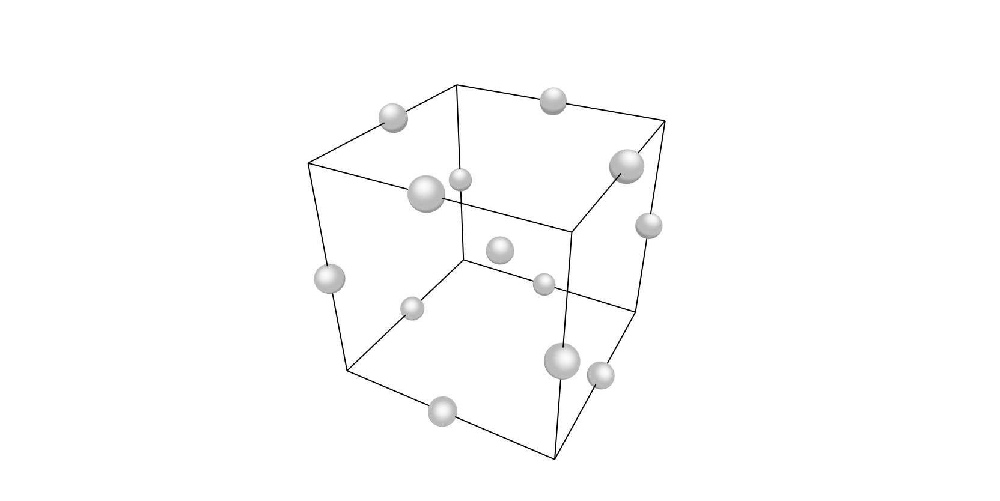

In this section, the following kinds of *response surface designs* will 
be described:

- [Box-Behnken](#box_behnken)
- [Central Composite](#central_composite)
- [Doehlert Design](#doehlert_design)
- [Blocked Central Composite Design](#blocked-central-composite-design-block_ccdesign)
- [Small Composite Design (Hartley)](#small-composite-design-hartley-small_composite_design)

!!! hint
    All available designs can be accessed after a simple import statement:
    ```pycon
    >>> from pydoe import (
    ...     bbdesign,
    ...     ccdesign,
    ...     doehlert_shell_design,
    ...     doehlert_simplex_design,
    ...     block_ccdesign,
    ...     small_composite_design,
    ... )
    ```

## Box-Behnken (`bbdesign`) {#box_behnken}



Box-Behnken designs can be created using the following simple syntax:

```python
bbdesign(n, center)
```

where `n` is the number of factors (at least 3 required) and `center`
is the number of center points to include. If no inputs given to
`center`, then a pre-determined number of points are automatically
included.

For 3, 4 and 5 factors, every pair of factors carries a $2^2$ factorial.
For 6, 7, 9, 10, 11, 12 and 16 factors, the design is Box and Behnken's
(1960) published design in incomplete blocks of 3, 4 or 5 factors: 48, 56,
120, 160, 176, 192 and 384 runs before the center points. Other numbers of
factors pair every two factors.

### Examples

The default 3-factor Box-Behnken design:

```pycon
>>> bbdesign(3)
array([[-1., -1.,  0.],
       [-1.,  1.,  0.],
       [ 1., -1.,  0.],
       [ 1.,  1.,  0.],
       [-1.,  0., -1.],
       [-1.,  0.,  1.],
       [ 1.,  0., -1.],
       [ 1.,  0.,  1.],
       [ 0., -1., -1.],
       [ 0., -1.,  1.],
       [ 0.,  1., -1.],
       [ 0.,  1.,  1.],
       [ 0.,  0.,  0.],
       [ 0.,  0.,  0.],
       [ 0.,  0.,  0.]])
```

A customized design with four factors, but only a single center point:

```pycon
>>> bbdesign(4, center=1)
array([[-1., -1.,  0.,  0.],
       [-1.,  1.,  0.,  0.],
       [ 1., -1.,  0.,  0.],
       [ 1.,  1.,  0.,  0.],
       [-1.,  0., -1.,  0.],
       [-1.,  0.,  1.,  0.],
       [ 1.,  0., -1.,  0.],
       [ 1.,  0.,  1.,  0.],
       [-1.,  0.,  0., -1.],
       [-1.,  0.,  0.,  1.],
       [ 1.,  0.,  0., -1.],
       [ 1.,  0.,  0.,  1.],
       [ 0., -1., -1.,  0.],
       [ 0., -1.,  1.,  0.],
       [ 0.,  1., -1.,  0.],
       [ 0.,  1.,  1.,  0.],
       [ 0., -1.,  0., -1.],
       [ 0., -1.,  0.,  1.],
       [ 0.,  1.,  0., -1.],
       [ 0.,  1.,  0.,  1.],
       [ 0.,  0., -1., -1.],
       [ 0.,  0., -1.,  1.],
       [ 0.,  0.,  1., -1.],
       [ 0.,  0.,  1.,  1.],
       [ 0.,  0.,  0.,  0.]])
```

## Central Composite (`ccdesign`) {#central_composite}


Central composite designs can be created and customized using the syntax:

```python
ccdesign(n, center, alpha, face, *, generators=None)
```

where

- `n` is the number of factors,
- `center` is a 2-tuple of center points (one for the factorial block, one for the star block, default (4, 4))
- `alpha` is either "orthogonal" (or "o", default) or "rotatable" (or "r")
- `face` is either "circumscribed" (or "ccc", default), "inscribed" (or "cci"), or "faced" (or "ccf").
- `generators` (keyword only) is a [`fracfact`](factorial.md) generator string, such as `"a b c d abcd"`, for a fractional factorial cube instead of the full $2^n$ factorial (the default, `None`). The "orthogonal" and "rotatable" distances then use the cube's run count $n_F$: the rotatable distance is $n_F^{1/4}$.


The two optional keyword arguments `alpha` and `face` help describe
how the variance in the quadratic approximation is distributed. Please
see the [NIST](http://www.itl.nist.gov/div898/handbook/pri/pri.htm) web pages
if you are uncertain which options are suitable for your situation.

For five or more factors a central composite design is usually built on a
resolution V half or quarter fraction. For 5 factors on the 16-run half
fraction, the rotatable distance is $16^{1/4} = 2$, as in Box and Draper
(2007, p. 491) and Montgomery (2012, p. 511):

```pycon
>>> H = ccdesign(5, center=(0, 0), alpha="r", generators="a b c d abcd")
>>> H.shape
(26, 5)
>>> float(abs(H).max())
2.0
```

The star points alone come from [`star`](#star), where `n_cube` is the
run count of the cube (by default $2^n$).

!!! note
    - 'ccc' and 'cci' can be rotatable designs, but 'ccf' cannot.
    - If `face` is specified, while `alpha` is not, then the default value of `alpha` is 'orthogonal'.

### Examples

Simplest input, assuming default kwargs:

```pycon
>>> ccdesign(2)
array([[-1.        , -1.        ],
       [-1.        ,  1.        ],
       [ 1.        , -1.        ],
       [ 1.        ,  1.        ],
       [ 0.        ,  0.        ],
       [ 0.        ,  0.        ],
       [ 0.        ,  0.        ],
       [ 0.        ,  0.        ],
       [-1.41421356,  0.        ],
       [ 1.41421356,  0.        ],
       [ 0.        , -1.41421356],
       [ 0.        ,  1.41421356],
       [ 0.        ,  0.        ],
       [ 0.        ,  0.        ],
       [ 0.        ,  0.        ],
       [ 0.        ,  0.        ]])
```

More customized input, say, for a set of computer experiments where there
isn't variability so we only need a single center point:

```pycon
>>> ccdesign(3, center=(0, 1), alpha="r", face="cci")
array([[-0.59460356, -0.59460356, -0.59460356],
       [-0.59460356, -0.59460356,  0.59460356],
       [-0.59460356,  0.59460356, -0.59460356],
       [-0.59460356,  0.59460356,  0.59460356],
       [ 0.59460356, -0.59460356, -0.59460356],
       [ 0.59460356, -0.59460356,  0.59460356],
       [ 0.59460356,  0.59460356, -0.59460356],
       [ 0.59460356,  0.59460356,  0.59460356],
       [-1.        ,  0.        ,  0.        ],
       [ 1.        ,  0.        ,  0.        ],
       [ 0.        , -1.        ,  0.        ],
       [ 0.        ,  1.        ,  0.        ],
       [ 0.        ,  0.        , -1.        ],
       [ 0.        ,  0.        ,  1.        ],
       [ 0.        ,  0.        ,  0.        ]])
```

## Doehlert Design (`doehlert_shell_design`, `doehlert_simplex_design`) {#doehlert_design}

An alternative and very useful design for second-order models is the **uniform shell design** proposed by Doehlert in 1970 [1](https://doi.org/10.2307/2346327).  
Doehlert designs are especially advantageous when optimizing multiple variables, requiring fewer experiments than central composite designs, while providing efficient and uniform coverage of the experimental domain.

The Doehlert design defines a **spherical experimental domain** and emphasizes **uniform space filling**. Although it is not orthogonal or rotatable, it is generally sufficient for practical applications.

The design consists of the center and the $k^2 + k$ points of the first
uniform shell. The shell points are the differences between every two
vertices of a regular simplex with unit edges: they all lie at distance 1
from the center, and each is at distance 1 from its nearest neighbors. For
two variables they form a regular hexagon, for three variables a
cuboctahedron. The total number of experiments is given by: $$ N = k^2 + k + C_0 $$
where

- $k$ = number of factors (variables)
- $C_0$ = number of center points

Two functions are included; they return the same shell points in the same
order:

- `doehlert_simplex_design(num_factors)`: one center point followed by the
  $k^2 + k$ shell points, $k^2 + k + 1$ rows in total. The first $k + 1$
  rows are the regular simplex (one vertex at the origin) the design is
  built from.
- `doehlert_shell_design(num_factors, num_center_points=1)`:
  `num_center_points` center replicates followed by the same shell points.
  With the default single center point it returns the same design as
  `doehlert_simplex_design`; `num_center_points=0` returns the shell alone.

Both raise `ValueError` if `num_factors` is less than 1;
`doehlert_shell_design` also if `num_center_points` is negative.

### Examples

The Doehlert design for 2 factors, the center and a regular hexagon:

```pycon
>>> doehlert_simplex_design(2)
array([[ 0.       ,  0.       ],
       [ 1.       ,  0.       ],
       [ 0.5      ,  0.8660254],
       [-1.       ,  0.       ],
       [-0.5      , -0.8660254],
       [ 0.5      , -0.8660254],
       [-0.5      ,  0.8660254]])
```

The Doehlert design for 3 factors, the center and the 12 vertices of a
cuboctahedron:

```pycon
>>> doehlert_simplex_design(3)
array([[ 0.        ,  0.        ,  0.        ],
       [ 1.        ,  0.        ,  0.        ],
       [ 0.5       ,  0.8660254 ,  0.        ],
       [ 0.5       ,  0.28867513,  0.81649658],
       [-1.        ,  0.        ,  0.        ],
       [-0.5       , -0.8660254 ,  0.        ],
       [-0.5       , -0.28867513, -0.81649658],
       [ 0.5       , -0.8660254 ,  0.        ],
       [ 0.5       , -0.28867513, -0.81649658],
       [-0.5       ,  0.8660254 ,  0.        ],
       [ 0.        ,  0.57735027, -0.81649658],
       [-0.5       ,  0.28867513,  0.81649658],
       [ 0.        , -0.57735027,  0.81649658]])
```

The same design with 3 center points instead of 1:

```pycon
>>> design = doehlert_shell_design(3, num_center_points=3)
>>> design.shape
(15, 3)
>>> design[:4]
array([[0., 0., 0.],
       [0., 0., 0.],
       [0., 0., 0.],
       [1., 0., 0.]])
>>> bool(np.allclose(np.linalg.norm(design[3:], axis=1), 1.0))
True
>>> bool(np.allclose(design[3:], doehlert_simplex_design(3)[1:]))
True
```

!!! note
    Doehlert designs are recommended for response surface modeling when good space coverage and fewer experimental runs are desired.


## Blocked Central Composite Design (`block_ccdesign`) {#blocked-central-composite-design-block_ccdesign}

When the factorial portion and the axial portion of a central composite
design must be run in separate blocks, `block_ccdesign` chooses the
axial distance `alpha` orthogonally so the block effect does not bias
the estimated factor effects, and returns a block label for each run.

```pycon
>>> design, blocks = block_ccdesign(n, center=(4, 4))  # (1)!
```

1. `n` — number of factors (≥ 2). `center` — number of center runs added
   to the factorial block and the axial block, respectively.

```pycon
>>> design, blocks = block_ccdesign(2, center=(2, 2))
>>> blocks
array([0, 0, 0, 0, 0, 0, 1, 1, 1, 1, 1, 1])
```

!!! note
    Block 0 is the $2^n$ factorial points plus `center[0]` center runs;
    block 1 is the $2n$ axial points plus `center[1]` center runs.

## Small Composite Design (Hartley) (`small_composite_design`) {#small-composite-design-hartley-small_composite_design}

Hartley's small composite design augments a two-level fractional
factorial (instead of a full $2^n$ factorial) with star points and
center runs. The fraction is the smallest regular fraction the search
finds (the smallest possible for up to 18 factors) in which no two-factor
interaction is aliased with another; a main effect may be aliased with a
two-factor interaction, which the star points then separate. The design
fits the full quadratic model with fewer runs than a central composite
design on the full $2^n$ factorial. For 3, 4, 5, 6, 7 and 9 factors the cube has
4, 8, 16, 16, 32 and 64 runs, as in Box and Draper (2007, p. 501).

```pycon
>>> small_composite_design(n, center=(4, 4))  # (1)!
```

1. `n` — number of factors (≥ 3). `center` — number of center runs
   added to the cube portion and the star portion, respectively.

For 4 factors this needs only 20 runs versus 30 for a standard CCD
built on the full $2^4$ factorial:

```pycon
>>> small_composite_design(4, center=(2, 2)).shape[0]
20
```

!!! note
    Reference: Hartley, H. O. (1959). Smallest composite designs for
    quadratic response surfaces. *Biometrics*, 15(4), 611-624.

## Building Blocks (`star`, `union`, `repeat_center`) {#building-blocks}

The central composite and Box-Behnken designs are assembled from three
small functions, which are also available on their own.

### Star points (`star`) {#star}

```python
star(n, alpha="faced", center=(1, 1), *, n_cube=None)
```

- `n`: number of factors.
- `alpha`: `"faced"` (default), `"orthogonal"` or `"rotatable"`; the full
  names are required here (the abbreviations accepted by `ccdesign` are
  not). Any other value raises `ValueError`.
- `center`: 2-tuple with the number of center points of the factorial
  block and of the star block (default `(1, 1)`). Only used by
  `"orthogonal"`.
- `n_cube` (keyword only): run count $n_F$ of the factorial (cube) portion
  the star points will be combined with. `None` (default) means the full
  factorial, $n_F = 2^n$. A value that is not a positive integer raises
  `ValueError`.

Returns the tuple `(H, a)`: `H` is the $2n \times n$ matrix of the star
points $\pm a$ on each axis, without center points, and `a` is the axial
distance:

- `"faced"`: $a = 1$;
- `"rotatable"`: $a = n_F^{1/4}$;
- `"orthogonal"`: with $n_0$ = `center[0]` and $n_{a0}$ = `center[1]`,

$$
a = \sqrt{\frac{n \, (1 + n_{a0} / (2n))}{1 + n_0 / n_F}} .
$$

```pycon
>>> H, a = star(3)
>>> H
array([[-1.,  0.,  0.],
       [ 1.,  0.,  0.],
       [ 0., -1.,  0.],
       [ 0.,  1.,  0.],
       [ 0.,  0., -1.],
       [ 0.,  0.,  1.]])
>>> a
1
>>> H, a = star(2, alpha="rotatable")
>>> H
array([[-1.41421356,  0.        ],
       [ 1.41421356,  0.        ],
       [ 0.        , -1.41421356],
       [ 0.        ,  1.41421356]])
>>> float(star(5, alpha="rotatable", n_cube=16)[1])
2.0
```

### Center points (`repeat_center`) {#repeat_center}

```python
repeat_center(n, repeat)
```

- `n`: number of factors.
- `repeat`: number of center points.

Returns a `repeat`-by-`n` array of zeros, the center-point portion of a
design in coded units.

```pycon
>>> repeat_center(3, 2)
array([[0., 0., 0.],
       [0., 0., 0.]])
```

### Stacking designs (`union`) {#union}

```python
union(H1, H2)
```

- `H1`, `H2`: 2D arrays with the same number of columns.

Returns the rows of `H1` followed by the rows of `H2`. For example, a
2-factor face-centered composite design with one center point is the
factorial points, the star points and the center:

```pycon
>>> union(union(ff2n(2), star(2)[0]), repeat_center(2, 1))
array([[-1., -1.],
       [-1.,  1.],
       [ 1., -1.],
       [ 1.,  1.],
       [-1.,  0.],
       [ 1.,  0.],
       [ 0., -1.],
       [ 0.,  1.],
       [ 0.,  0.]])
```

## More Information

If the user needs more information about appropriate designs, please 
consult the following articles:

- [Box-Behnken designs](http://en.wikipedia.org/wiki/Box-Behnken_design)
- [Central composite designs](http://en.wikipedia.org/wiki/Central_composite_design)
- [Doehlert design](https://academic.oup.com/jrsssc/article/19/3/231/6882590)

There is also a wealth of information on the [NIST](http://www.itl.nist.gov/div898/handbook/pri/pri.htm) website about the
various design matrices that can be created as well as detailed information
about designing/setting-up/running experiments in general.
