# Who uses PyDOE?

PyDOE is a widely used Python library for *design of experiments (DOE)*. Its users range from individual researchers to global organizations, spanning academia, industry, and open-source projects. It supports applications in simulation-based optimization, engineering workflows, scientific research, and data-driven model development.

**Selected Testimonials**  
Below are some small selection of the many institutes and companies that use PyDOE.

[{ .user-logo .logo-h77 }](https://www.nasa.gov/)  
Engineering simulations such as CFD and turbomachinery design are the target of **GlennOPT**, a standalone Python multi-objective optimization tool developed by *NASA*. Its evolutionary strategies (Differential Evolution and NSGA methods) tolerate failed simulations by giving them a poor objective value, and extra performance parameters beyond the objectives can be tracked and constrained. Every evaluation is recorded, runs restart from a population folder, stuck runs are killed after a timeout, and results export to Tecplot and CSV. For simulation-based optimization, the `DOE` module samples the evaluation parameters through *PyDOE*'s `lhs` (maximin criterion), `ccdesign`, `bbdesign` and `fullfact`.
> Source: <a href="https://github.com/nasa/GlennOPT" style="color: #484848;">github.com/nasa/GlennOPT</a>

 

[{ .user-logo .logo-h49 }](https://openmdao.org/)  
Developed by *NASA Glenn Research Center*, **OpenMDAO** is an open-source, high-performance computing platform written in Python for systems analysis and multidisciplinary optimization. Complex coupled models can be decomposed into components that are easier to build and maintain, yet still be solved in a tightly coupled manner with efficient parallel numerical methods. Gradient-based optimization with analytic derivatives over hundreds or thousands of design variables is the main focus, though gradient-free optimization, mixed-integer nonlinear programming and design space exploration are supported as well. Installed with `openmdao[doe]`, *PyDOE* backs the DOE case generators (full-factorial via `fullfact`, generalized subset via `gsd`, Plackett-Burman and Latin hypercube) and supplies `lhs` initial populations to the genetic-algorithm and differential-evolution drivers.
> Source: <a href="https://github.com/OpenMDAO/OpenMDAO" style="color: #484848;">github.com/OpenMDAO/OpenMDAO</a>

 

[{ .user-logo .logo-h49 }](https://ai.meta.com/research/)  
Widely used for hyperparameter tuning and black-box engineering problems, **Nevergrad** is the gradient-free optimization platform for Python from *Meta Research*. Evolution strategies, differential evolution, particle swarm, Bayesian optimization and many other derivative-free methods sit behind a single interface such as `NGOpt`, with support for bounded continuous, discrete and mixed parametrizations.
> Source: <a href="https://github.com/facebookresearch/nevergrad" style="color: #484848;">github.com/facebookresearch/nevergrad</a>

 

[{ .user-logo .logo-h63 }](https://www.ibm.com/)  
For *physics-informed machine learning*, *IBM*'s open-source **SimulAI** toolkit, published on PyPI as simulai-toolkit, offers data-driven Python pipelines. Physics-Informed Neural Networks (PINNs), DeepONets and autoencoders are combined for scientific computing and reduced-order modeling, so that surrogate models of physical systems can be built, trained and evaluated in one framework. The intent is to unify state-of-the-art machine-learning techniques for physical systems in a single toolkit.
> Source: <a href="https://github.com/ibm/simulai" style="color: #484848;">github.com/ibm/simulai</a>

 

[{ .user-logo .logo-h84 }](https://www.paypal.com/)  
Model building with big data and fast real-time pre-processing, even for a large number of QPS and using only Python, is what the *PSP Data Team* at *PayPal* built **Gators** to handle. This data preprocessing and feature engineering library sits on top of Polars and offers 108 preprocessing transformers across 11 categories behind a scikit-learn-style `fit`/`transform` API, with pipeline support and ONNX export for low-latency inference. Benchmarks show it faster than scikit-learn and feature-engine on common preprocessing tasks, and the same code can move from notebook to production.
> Source: <a href="https://github.com/paypal/gators" style="color: #484848;">github.com/paypal/gators</a>

 

[{ .user-logo .logo-h42 }](https://www.llnl.gov/)  
**Merlin**, from *Lawrence Livermore National Laboratory*, is a distributed task-queuing tool for machine-learning-based HPC workflows that scale to very large simulation ensembles (100 million runs on the Sierra supercomputer), producing data sets big enough to train neural-network surrogates for design optimization and uncertainty quantification. Two other laboratory codes call *PyDOE*. Utilities for Merlin workflows come from **Merlin-Spellbook**, whose sample generator draws parameter samples on the unit hypercube with `lhs`, `star` and `ccdesign` (face-centered, circumscribed and inscribed). **Zero-RK** (Zero Order Reaction Kinetics) cuts the simulation time of chemically reacting systems by orders of magnitude with sparse, preconditioned, adaptive matrix methods, and in its diesel surrogate-optimizer example `lhs` picks the starting species compositions.

> Sources:  
<a href="https://github.com/llnl/merlin" style="color: #484848;">github.com/llnl/merlin</a>  
<a href="https://github.com/llnl/zero-rk" style="color: #484848;">github.com/llnl/zero-rk</a>  
<a href="https://github.com/llnl/merlin-spellbook" style="color: #484848;">github.com/llnl/merlin-spellbook</a>

 

[{ .user-logo .logo-h49 }](https://www.lanl.gov/)  
Parallel, multi-fidelity Bayesian optimization with serial and MPI-enabled asynchronous workflows is the job of **Bohydra** ("many heads, one optimizer"), a package from *Los Alamos National Laboratory*. Single- and multi-fidelity Gaussian-process emulators, Bayesian optimization with Expected Improvement and constrained optimization with probabilistic feasibility weighting are included, together with an MPI coordinator/worker pattern for asynchronous runs and SLURM helper templates for HPC clusters. The initial design of the Bayesian-optimization loop comes from `lhs` in *PyDOE*, set to the maximin criterion, which both the MPI coordinator and the SLURM initialization template call.
> Source: <a href="https://github.com/lanl/bohydra" style="color: #484848;">github.com/lanl/bohydra</a>

 

[{ .user-logo .logo-h42 }](https://www.nrel.gov/)  
At the *National Laboratory of the Rockies* (formerly the *National Renewable Energy Laboratory*, NREL), wind-energy systems engineering is done with **WISDEM** (**W**ind-Plant **I**ntegrated **S**ystem **D**esign and **E**ngineering **M**odel). This OpenMDAO-based family of models estimates overall wind-plant cost of energy from turbine and plant cost, energy production and financial models, with modules for rotor, tower, drivetrain, floating-platform and balance-of-system design, and couples them for multidisciplinary design optimization and cost analysis. When its NSGA-II optimization driver starts, the initial population of design variables within their bounds is generated by `lhs` from *PyDOE*.
> Source: <a href="https://github.com/NLRWindSystems/WISDEM" style="color: #484848;">github.com/NLRWindSystems/WISDEM</a>

 

[{ .user-logo .logo-h63 }](https://www.sandia.gov/)  
*Sandia National Laboratories* publishes **pvOps**, a Python package for empirical analysis of photovoltaic (PV) field data. Text-based maintenance logs are fused with time-series production data through modules for text processing, text-to-time-series mapping, time-series analysis and current-voltage (IV) curves, and example datasets and tutorials are included. The IV-curve simulator builds Latin hypercube designs over its input features with *PyDOE*'s `lhs`.
> Source: <a href="https://github.com/sandialabs/pvOps" style="color: #484848;">github.com/sandialabs/pvOps</a>

 

[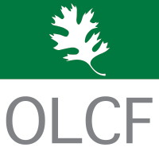{ .user-logo .logo-h84 }](https://www.olcf.ornl.gov/about-olcf/staff-sections/advanced-technologies/ai-analytics-scalable-methods/)
[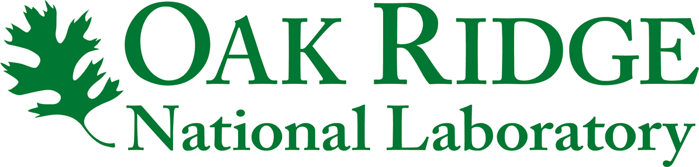{ .user-logo .logo-h56 }](https://www.ornl.gov/)  
"Entropy-driven Optimal Sub-sampling of Fluid Dynamics for Developing Machine-learned Surrogates" is the paper behind **DataSiftML**, developed by the *Analytics and AI Methods at Scale* group of the Oak Ridge Leadership Computing Facility at *Oak Ridge National Laboratory*. The code sub-samples CFD simulation data, such as an OpenFOAM flow-around-a-cylinder case, into compact training sets for machine-learned surrogate models, choosing among maximum-entropy, random, cluster-based and kNN strategies.
> Source: <a href="https://github.com/at-aaims/DataSiftML" style="color: #484848;">github.com/at-aaims/DataSiftML</a>

 

[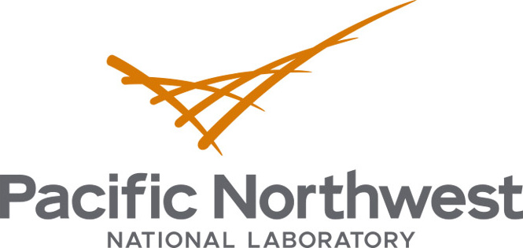{ .user-logo .logo-h70 }](https://www.pnnl.gov/)  
*PyDOE* appears in three projects at *Pacific Northwest National Laboratory*. **AMBRS** is a Python workflow that runs a curated set of aerosol box models (PartMC and MAM4) so that their parameterizations can be compared systematically, and its `lhs` routine builds perturbed-parameter ensembles from an ensemble specification by calling *PyDOE*'s `lhs`. Efficient training of physics-informed machine-learning models, with self-adaptive weighting and sampling, is the purpose of the PyTorch library **ET-PINN**, whose geometry sampler offers `lhs` alongside Halton sequences for generating training points. That same `lhs`-based sampler serves **ArGEnT**, an arbitrary-geometry-encoded transformer for operator learning, which also draws `lhs` point clouds to represent geometries in its laminar-airfoil, lid-driven and rod examples.

> Sources:  
<a href="https://github.com/pnnl/ambrs" style="color: #484848;">github.com/pnnl/ambrs</a>  
<a href="https://github.com/pnnl/ET-PINN" style="color: #484848;">github.com/pnnl/ET-PINN</a>  
<a href="https://github.com/pnnl/ArGEnT" style="color: #484848;">github.com/pnnl/ArGEnT</a>

 

[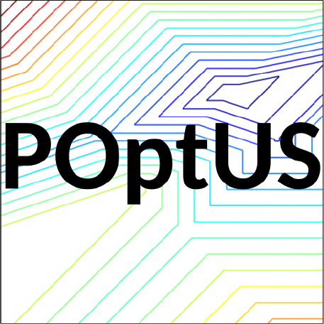{ .user-logo .logo-h84 }](https://github.com/POptUS)
[{ .user-logo .logo-h56 }](https://www.anl.gov/)  
Simulation-based optimization software from *Argonne National Laboratory* and *Inria* is hosted under *POptUS* (**P**ractical **Opt**imization **U**sing **S**tructure). One of its repositories, **StochDFO**, collects algorithms for stochastic derivative-free optimization and currently consists of the OGPIT tool: Python sources that run in parallel with mpi4py and take their test problems from the BenDFO collection. OGPIT's hetGPy-based module calls *PyDOE*'s `lhs` (imported as `lhspy`) with the maximin criterion, both to build the initial design of its Gaussian-process-based search and to generate candidate points inside the current trust region.
> Source: <a href="https://github.com/POptUS/StochDFO" style="color: #484848;">github.com/POptUS/StochDFO</a>

 

[{ .user-logo .logo-h49 }](https://www.lbl.gov/)  
Dynamic facades such as electrochromic windows, blinds and shades, together with lighting and HVAC systems, are controlled by **AFC** (**A**dvanced **F**acade **C**ontroller), a model-predictive control package from the *Windows Group* in the *Energy Technologies Area* of *Lawrence Berkeley National Laboratory*. Using weather forecasts and room and floor temperature measurements, it optimizes setpoints over a horizon of typically 24 hours to minimize electricity cost and/or emissions while accounting for visual and thermal comfort (glare, daylight, view). The package builds on LBNL's DOPER and FMLC frameworks. So that model-parameter tuning can run from multiple starting points, its `rctuning` optimizer draws starting parameter sets with *PyDOE*'s `lhs`.
> Source: <a href="https://github.com/LBNL-ETA/AFC" style="color: #484848;">github.com/LBNL-ETA/AFC</a>

 

[{ .user-logo .logo-h84 }](https://agilebiofoundry.org/)  
Alongside its multiomics paper, the *Agile BioFoundry*, a consortium of U.S. Department of Energy national laboratories for synthetic biology and biomanufacturing, publishes a companion repository. Jupyter notebooks there combine **ICE**, **OMG**, **EDD** and **ART** to store strain information, generate mock omics data, store experiment data and let machine learning suggest new experiments. Working together on a simulated data set, the tools pinpoint genetic modifications that improve production of isoprenol, a potential biofuel.
> Source: <a href="https://github.com/AgileBioFoundry/multiomicspaper" style="color: #484848;">github.com/AgileBioFoundry/multiomicspaper</a>

 

[{ .user-logo .logo-h42 }](https://diana-hep.org/)
[{ .user-logo .logo-h56 }](https://www.princeton.edu/)
[{ .user-logo .logo-h70 }](https://www.uc.edu/)
[{ .user-logo .logo-h49 }](https://www.nyu.edu/)
[{ .user-logo .logo-h63 }](https://www.unl.edu/)
[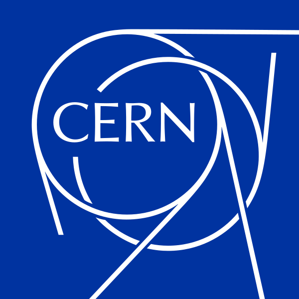{ .user-logo .logo-h77 }](https://home.cern/)  
Estimating excursion sets (iso-surfaces) of one or many expensive black-box functions, such as the exclusion contours of high-energy physics searches computed from costly Monte Carlo simulations, is what **excursion** does efficiently with Gaussian-process-based Bayesian optimization. This package comes from *DIANA-HEP* (*Data-Intensive Analysis for High Energy Physics*), and points in its Latin hypercube sampler module are drawn with *PyDOE*'s `lhs`. Funded by the NSF Software Infrastructure for Sustained Innovation (SI2) program, the DIANA-HEP project brought together *Princeton University*, the *University of Cincinnati*, *New York University* and the *University of Nebraska-Lincoln*. It builds tools that help experiments at CERN's Large Hadron Collider and other facilities acquire, reduce and analyze petabytes of data.
> Source: <a href="https://github.com/diana-hep/excursion" style="color: #484848;">github.com/diana-hep/excursion</a>

 

[{ .user-logo .logo-h56 }](https://www.neasqc.eu/)
[{ .user-logo .logo-h56 }](https://cordis.europa.eu/project/id/951821)  
Coordinated by *Atos*, the European Horizon 2020 project *NEASQC* (**NE**xt **A**pplication**S** of **Q**uantum **C**omputing) brings together 12 companies and research labs to build industrial applications for near-term quantum computers. **WP6_QNLP**, the repository of work package 6.1, is a benchmarking solution for quantum natural language processing that pre-processes data and trains and evaluates quantum and classical NLP models for text classification. Work package 3 hosts **TNBS** (The NEASQC Benchmark Suite), with myQLM-compatible implementations of benchmark test cases for probability loading, amplitude estimation, phase estimation and parent-Hamiltonian kernels.

> Sources:  
<a href="https://github.com/NEASQC/WP6_QNLP" style="color: #484848;">github.com/NEASQC/WP6_QNLP</a>  
<a href="https://github.com/NEASQC/WP3_Benchmark" style="color: #484848;">github.com/NEASQC/WP3_Benchmark</a>

 

[{ .user-logo .logo-h84 }](https://www.gov.uk/government/organisations/department-for-energy-security-and-net-zero)  
How much renewable generation and storage an energy system needs is the question behind **SCORES** (**S**torage and **C**ost **O**ptimisation for **R**enewable **E**nergy **S**ystems), developed by the *SICE* team under the UK *Department for Energy Security and Net Zero*. The model compares archival weather data, from hourly MERRA-2 and ERA5 satellite data across a range of weather years, with demand data to predict how much electricity storage is needed. Before optimising the system to meet a specified reliability requirement, the routines in `system.py` search over generator capacity ratios with *PyDOE*'s `lhs` to find a good starting set of generation capacities.
> Source: <a href="https://github.com/DESNZ-SICE/SCORES" style="color: #484848;">github.com/DESNZ-SICE/SCORES</a>

 

[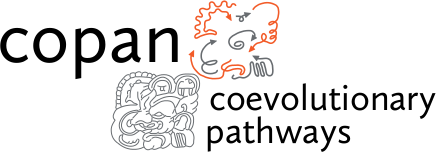{ .user-logo .logo-h63 }](https://www.pik-potsdam.de/copan)
[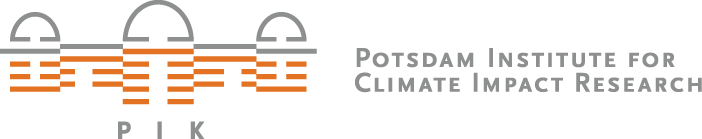{ .user-logo .logo-h63 }](https://www.pik-potsdam.de/en)  
Tipping cascades on complex networks can be simulated with **pycascades**, a Python framework from the *copan* (Coevolutionary Pathways) collaboration at the *Potsdam Institute for Climate Impact Research*. It offers tipping elements with cusp or Hopf bifurcations, arbitrary networks plus ready-made Erdős-Rényi, Barabási-Albert and Watts-Strogatz topologies, and optional stochastic forcing such as Gaussian noise or Lévy and Cauchy processes. Examples include the Amazon rainforest moisture-recycling network, interacting climate tipping elements and the global trade network. For the earth-system case, the `lhs_preparator` script calls *PyDOE*'s `lhs` for 1,000 Latin hypercube samples over 11 parameters.
> Source: <a href="https://github.com/pik-copan/pycascades" style="color: #484848;">github.com/pik-copan/pycascades</a>

 

[{ .user-logo .logo-h84 }](https://github.com/psnc-qcg)
[{ .user-logo .logo-h35 }](https://www.psnc.pl/)  
Learning, using and benchmarking different quantum algorithms, hardware and problem formulations becomes simpler with Quantum Launcher, the high-level Python library that the *Poznań Supercomputing and Networking Center* publishes as **QCG-QuantumLauncher** within its QCG tooling for quantum computing. A run is split into a problem (such as MaxCut or Exact Cover), an algorithm (such as QAOA, FALQON or BBS) and a backend (quantum hardware or a local simulator), with predefined sets of each, automated problem processing and an asynchronous architecture for standalone or grid execution.
> Source: <a href="https://github.com/psnc-qcg/QCG-QuantumLauncher" style="color: #484848;">github.com/psnc-qcg/QCG-QuantumLauncher</a>

 

[{ .user-logo .logo-h49 }](https://idmod.org/)  
The *Institute for Disease Modeling* (Gates Foundation) builds its sub-national tailoring (SNT) workflow, **emodpy-snt**, on the EMOD malaria transmission model. Collected there are the core scripts shared across SNT projects: preparing demographic, vector and intervention inputs, clustering administrative regions by seasonality and transmission intensity, calibrating each region against survey prevalence data, and simulating past and future intervention scenarios. Python and R scripts are combined with post-processing and validation steps. When simulation sweeps are set up, Latin hypercube parameter samples for individual districts are drawn with *PyDOE*'s `lhs`.
> Source: <a href="https://github.com/InstituteforDiseaseModeling/emodpy-snt" style="color: #484848;">github.com/InstituteforDiseaseModeling/emodpy-snt</a>

 

[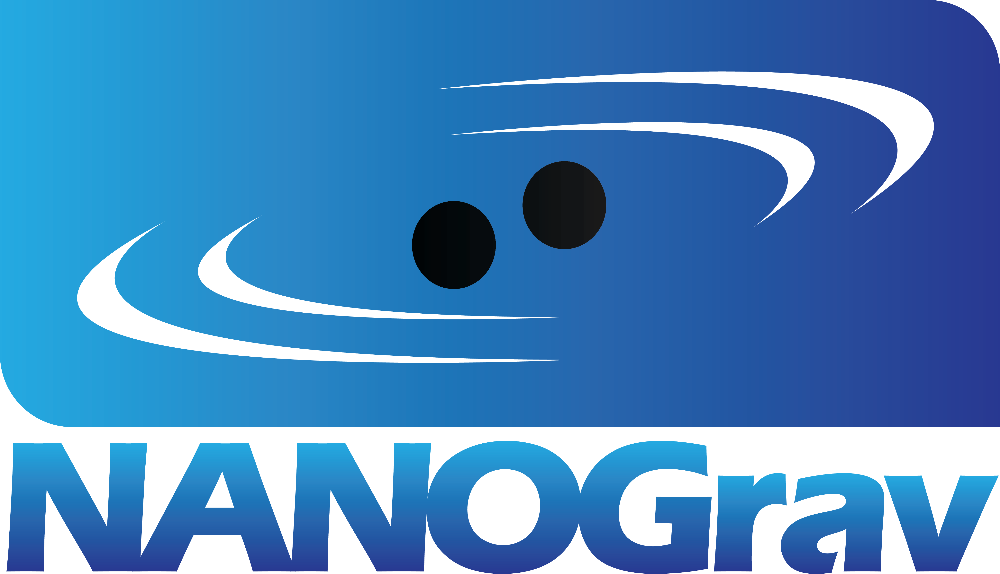{ .user-logo .logo-h63 }](https://nanograv.org/)  
Massive black-hole binary population synthesis for gravitational-wave calculations is the domain of **Holodeck**, an astrophysics package developed by *NANOGrav*. Synthetic populations of supermassive black-hole binaries are built from semi-analytic models, cosmological hydrodynamic simulations and observationally derived galaxy-merger catalogs, for gravitational-wave background studies and related analyses. Stable versions are distributed on PyPI as holodeck-gw. When its library-generation scripts choose the parameters of semi-analytic model populations, they can use either of two Latin hypercube sampling backends, *PyDOE* or SciPy.
> Source: <a href="https://github.com/nanograv/holodeck" style="color: #484848;">github.com/nanograv/holodeck</a>

 

[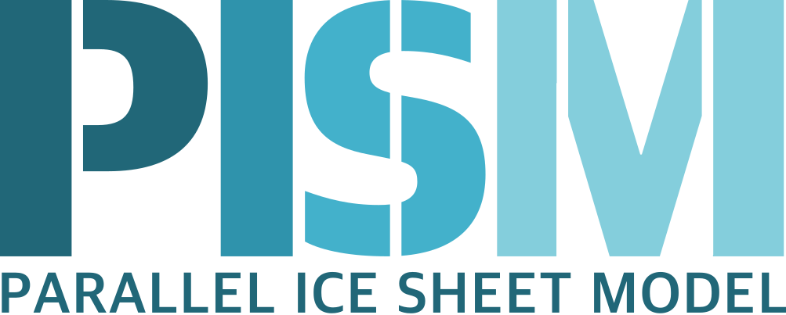{ .user-logo .logo-h56 }](https://www.pism.io/)
[{ .user-logo .logo-h49 }](https://www.uaf.edu/)  
Under a NASA ROSES award, the *Parallel Ice Sheet Model* (PISM) team at the *University of Alaska Fairbanks* develops **pism-ragis**, a reanalysis of the Greenland Ice Sheet (RAGIS). Its data-assimilation framework combines sparse observations with the PISM ice sheet model to reconstruct the state of the ice sheet from 1980 to 2020 using probabilistic filtering methods, with runs carried out on HPC systems. In the uncertainty-quantification scripts the default sampler is *PyDOE*'s `lhs` (via pyDOE3), which draws Latin hypercube samples of the prior parameter distributions for the ensemble.
> Source: <a href="https://github.com/pism/pism-ragis" style="color: #484848;">github.com/pism/pism-ragis</a>

 

[{ .user-logo .logo-h77 }](https://pv.mit.edu/)
[{ .user-logo .logo-h63 }](https://www.mit.edu/)  
**GPyOpt_DFT**, from the *Accelerated Materials Laboratory for Sustainability* (PV-Lab) at the *Massachusetts Institute of Technology*, is a fork of GPyOpt that adds a DFT-constrained acquisition function (EI_DFT) for physics-constrained Bayesian optimization of ternary MAPbI/FAPbI/CsPbI perovskite mixtures. The Latin hypercube initial design of its optimization loop is built with *PyDOE*'s `lhs`, and the lab also uses *PyDOE* in **BOBartender**. Within the *Data to AI Lab*'s **ML Bazaar** project sits **BTB** (**B**ayesian **T**uning and **B**andits), a simple, extensible backend for auto-tuning and model-selection systems such as AutoML systems.

> Sources:  
<a href="https://github.com/PV-Lab/GPyOpt_DFT" style="color: #484848;">github.com/PV-Lab/GPyOpt_DFT</a>  
<a href="https://github.com/MLBazaar/BTB" style="color: #484848;">github.com/MLBazaar/BTB</a>

 

[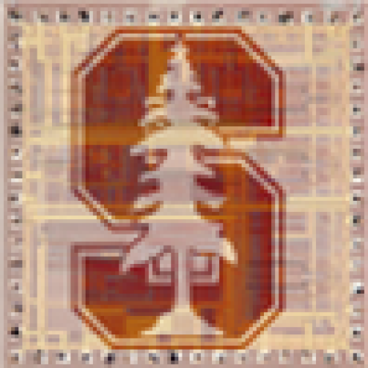{ .user-logo .logo-h77 }](https://www-vlsi.stanford.edu/)
[{ .user-logo .logo-h42 }](https://www.stanford.edu/)  
Mixed-signal systems-on-chip are validated through analog functional modeling in **DaVE**, a set of methodologies and tools from the *Stanford VLSI Research Group*: **mLingua** covers event-driven piecewise-linear models in SystemVerilog, **mProbo** checks that analog models match their transistor-level circuits, and **mGenero** handles model generation. Latin hypercube test vectors for comparing models against circuits come from *PyDOE*'s `lhs` in the model checker. Also at *Stanford University*, the *Eddy* atmospheric-dynamics group's **QBO-History-Matching** calibrates the AD99 gravity-wave parameterization in the MiMA climate model against the Quasi-Biennial Oscillation, starting from an initial Latin hypercube sample of the parameter space.

> Sources:  
<a href="https://github.com/StanfordVLSI/DaVE" style="color: #484848;">github.com/StanfordVLSI/DaVE</a>  
<a href="https://github.com/Eddy-Stanford/QBO-History-Matching" style="color: #484848;">github.com/Eddy-Stanford/QBO-History-Matching</a>

 

[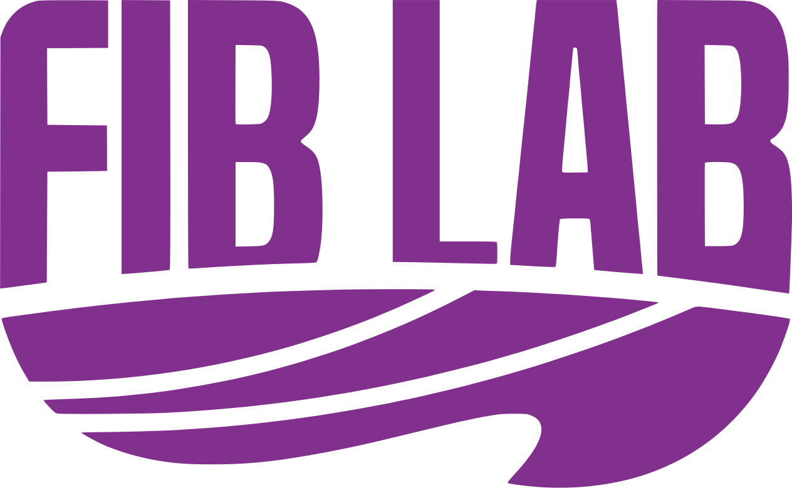{ .user-logo .logo-h70 }](http://fi.ee.tsinghua.edu.cn/)
[{ .user-logo .logo-h84 }](https://www.tsinghua.edu.cn/en/)  
"Modeling User Fatigue for Sequential Recommendation", a SIGIR 2024 paper from the *FIB Lab* at *Tsinghua University*, is officially implemented in **FRec**. Built on Microsoft Recommenders and TensorFlow, the code trains the FRec sequential recommender on a Taobao dataset and includes the CLSR and SLiRec baselines for comparison.
> Source: <a href="https://github.com/tsinghua-fib-lab/SIGIR24-FRec" style="color: #484848;">github.com/tsinghua-fib-lab/SIGIR24-FRec</a>

 

[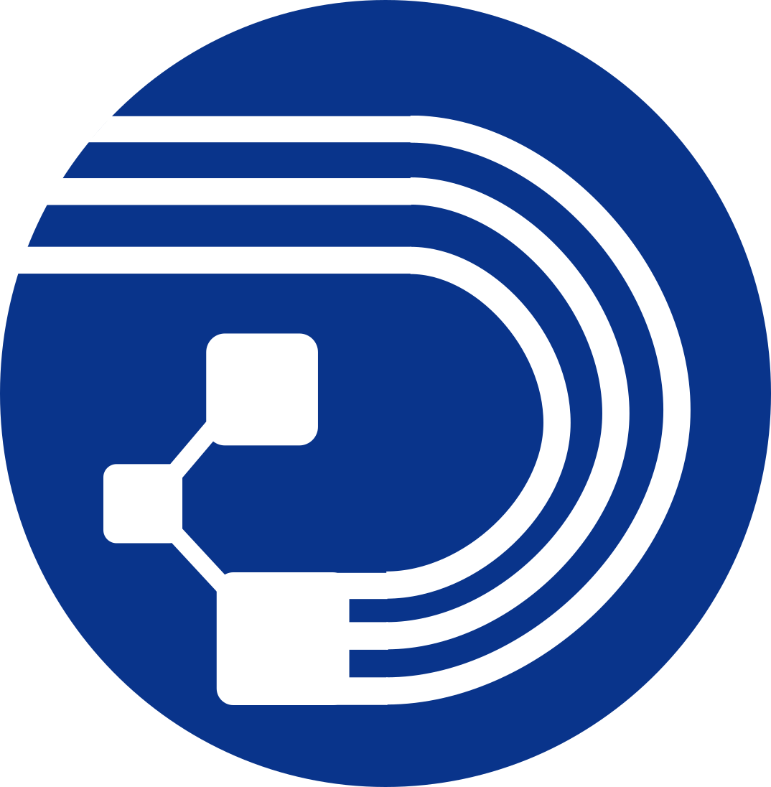{ .user-logo .logo-h84 }](https://github.com/PKU-DAIR)
[{ .user-logo .logo-h84 }](https://www.pku.edu.cn/)  
Database knobs are the focus of two tools from the *Data and Intelligence Research (DAIR) Lab* at *Peking University*. **DBTune** (VLDB'22) is a configuration tuning system that automatically finds good knob settings for performance, resource-oriented or multi-objective tuning, covering knob selection, configuration tuning and transfer learning from past tasks, while its companion **KnobsTuningEA** is an experimental evaluation of knob-tuning methods with a surrogate-based benchmark. In both, knob configurations across the configuration space are sampled by maximin-criterion `lhs` from *PyDOE*. The university's *Yue Yang group* develops **QKoopman**, a data-driven quantum Koopman method that combines deep learning and quantum algorithms to simulate nonlinear dynamics such as reaction-diffusion systems and 2D turbulence.

> Sources:  
<a href="https://github.com/PKU-DAIR/DBTune" style="color: #484848;">github.com/PKU-DAIR/DBTune</a>  
<a href="https://github.com/PKU-DAIR/KnobsTuningEA" style="color: #484848;">github.com/PKU-DAIR/KnobsTuningEA</a>  
<a href="https://github.com/YYgroup/QKoopman" style="color: #484848;">github.com/YYgroup/QKoopman</a>

 

[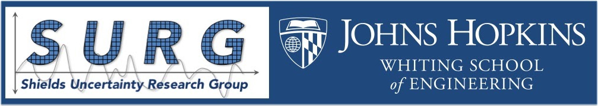{ .user-logo .logo-h49 }](https://sites.google.com/site/jhusurg/)  
Michael D. Shields directs *SURGroup*, which develops **UQpy** (**U**ncertainty **Q**uantification with **Py**thon), a general-purpose Python toolbox for modeling uncertainty in physical and mathematical systems. Used in engineering and scientific contexts, it implements sampling, uncertainty propagation, surrogate models and sensitivity analysis. In the stratified-sampling module, the seeds of rectangular strata are placed on a full factorial grid by a `fullfact` routine adapted from *PyDOE*.
> Source: <a href="https://github.com/SURGroup/UQpy" style="color: #484848;">github.com/SURGroup/UQpy</a>

 

[{ .user-logo .logo-h63 }](https://www.matter.toronto.edu/)
[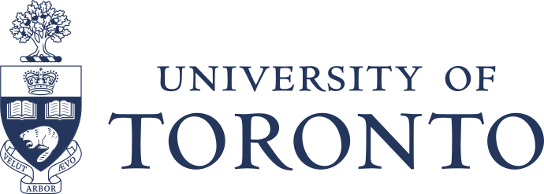{ .user-logo .logo-h63 }](https://www.utoronto.ca/)  
Self-driving laboratories need a brain, or experiment planner, and **Atlas** is meant to fill that role. The *Matter Lab* at the *University of Toronto* built this Python package for Bayesian optimization in the experimental sciences with the *Vector Institute*, on GPyTorch and BoTorch; it handles categorical and mixed parameter spaces as well as multi-objective, noisy, constrained, multi-fidelity and meta-learning optimization. At the same university, *Rotman FinHub* develops **deep-macrofin**, a deep-learning framework for solving continuous-time equilibrium models in macroeconomics and finance, whose initial example scripts import `lhs` from *PyDOE* for sampling.

> Sources:  
<a href="https://github.com/the-matter-lab/atlas" style="color: #484848;">github.com/the-matter-lab/atlas</a>  
<a href="https://github.com/rotmanfinhub/deep-macrofin" style="color: #484848;">github.com/rotmanfinhub/deep-macrofin</a>

 

[{ .user-logo .logo-h49 }](https://db.cs.cmu.edu/)
[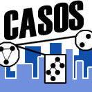{ .user-logo .logo-h84 }](https://github.com/CASOS-IDeaS-CMU)
[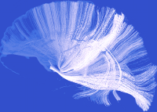{ .user-logo .logo-h70 }](https://github.com/CoAxLab)
[{ .user-logo .logo-h35 }](https://www.cmu.edu/)  
Machine learning drives **OtterTune**, the *Carnegie Mellon University Database Group*'s tool for automatically finding good settings for a database management system's configuration knobs, and training data from previous tuning sessions is reused along the way. When a session has too little data for its models, or runs in LHS mode, knob configurations are generated by *PyDOE*'s `lhs` with the maximin criterion. Elsewhere at CMU, the *CASOS IDeaS Center* maintains misinformation-source detection code, the *CoAx Lab* draws initial parameter sets with `lhs` in **RADD** to fit decision models to behavioral data, and the *MARS* project builds **model-learner**, its intent-discovery module.

> Sources:  
<a href="https://github.com/cmu-db/ottertune" style="color: #484848;">github.com/cmu-db/ottertune</a>  
<a href="https://github.com/CASOS-IDeaS-CMU/Detection-and-Discovery-of-Misinformation-Sources" style="color: #484848;">github.com/CASOS-IDeaS-CMU/Detection-and-Discovery-of-Misinformation-Sources</a>  
<a href="https://github.com/CoAxLab/radd" style="color: #484848;">github.com/CoAxLab/radd</a>  
<a href="https://github.com/cmu-mars/model-learner" style="color: #484848;">github.com/cmu-mars/model-learner</a>

 

[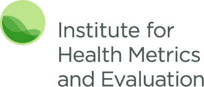{ .user-logo .logo-h70 }](https://www.healthdata.org/)
[{ .user-logo .logo-h49 }](https://www.washington.edu/)  
Public-health microsimulation models at the *Institute for Health Metrics and Evaluation* (University of Washington) are built as **Vivarium** models. One such research repository, **vivarium_gates_lsff**, holds model specifications, simulation and results tooling, and data artifacts for Uganda and the United Republic of Tanzania. The institute runs several other Vivarium projects as well.
> Source: <a href="https://github.com/ihmeuw/vivarium_gates_lsff" style="color: #484848;">github.com/ihmeuw/vivarium_gates_lsff</a>

 

[{ .user-logo .logo-h77 }](https://queens-py.github.io/queens/)
[{ .user-logo .logo-h63 }](https://www.tum.de/en/)  
With the *Institute for Computational Mechanics* at the *Technical University of Munich*, a Python framework called **QUEENS** (**Q**uantification of **U**ncertain **E**ffects in **En**gineering **S**ystems) was developed for solver-independent multi-query analyses of large-scale computational models. Parameter studies, sensitivity analysis, surrogate modeling, uncertainty quantification and Bayesian inverse analysis are all covered, and a modular architecture for parallel model queries scales from a laptop to an HPC cluster. The Latin hypercube sampling iterator first generates samples in the unit hypercube with *PyDOE*'s `lhs`, then maps them to the model's input distributions.
> Source: <a href="https://github.com/queens-py/queens" style="color: #484848;">github.com/queens-py/queens</a>

 

[{ .user-logo .logo-h49 }](https://www.u-tokyo.ac.jp/en/)  
Researchers in the *Tsuda Laboratory* at *The University of Tokyo* wrote **POPSL**, the official PyTorch implementation of Preference-Optimized Pareto Set Learning (PO-PSL) for black-box multi-objective optimization. Pareto set learning is framed as a bilevel problem: preference vectors are optimized with a differentiable cross-entropy method so that they spread evenly over the Pareto front, while Gaussian processes act as surrogate models. Benchmark problems such as ZDT3, DTLZ2, DTLZ5 and RE5 ship with the code.
> Source: <a href="https://github.com/tsudalab/POPSL" style="color: #484848;">github.com/tsudalab/POPSL</a>

 

[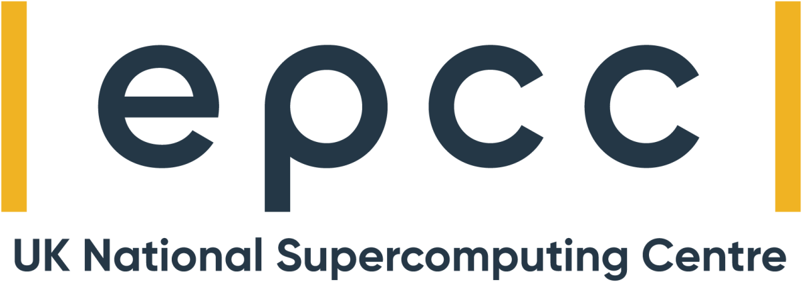{ .user-logo .logo-h63 }](https://www.epcc.ed.ac.uk/)
[{ .user-logo .logo-h56 }](https://www.ed.ac.uk/)  
Robust optimisation looks for solutions that stay optimal under perturbations within a disturbance neighbourhood, and **pyrobust** implements such methods in Python. It comes from *Prof. Jonathan Fieldsend's group* at the *University of Exeter* together with *EPCC*, the supercomputing centre of the *University of Edinburgh*, and its core methods exploit the population's search history and resample the best individuals. Latin hypercube sampling goes through *PyDOE*'s `lhs`, with maximin as the default criterion, while Sobol' sampling uses sobol_seq.
> Source: <a href="https://github.com/EPCCed/pyrobust" style="color: #484848;">github.com/EPCCed/pyrobust</a>

 

[{ .user-logo .logo-h49 }](https://eesd.epfl.ch/)
[{ .user-logo .logo-h49 }](https://www.epfl.ch/)  
Pareto-like Sequential Sampling (PSS), a heuristic for global optimisation published in the journal Soft Computing, has its source code in **pareto-optimizer**, developed by the *Earthquake Engineering and Structural Dynamics Laboratory* at *EPFL*. The algorithm and its benchmarks are implemented in C++14, Python and Octave (Matlab). In the Python version, the initial population of the search is generated by *PyDOE*'s `lhs` under the maximin criterion.
> Source: <a href="https://github.com/eesd-epfl/pareto-optimizer" style="color: #484848;">github.com/eesd-epfl/pareto-optimizer</a>

 

[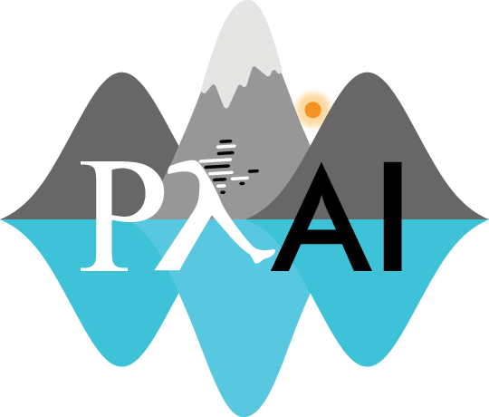{ .user-logo .logo-h77 }](https://plai.cs.ubc.ca)
[{ .user-logo .logo-h56 }](https://www.ubc.ca/)  
Research code for the thermodynamic variational objective (TVO) from the *Pacific Laboratory for Artificial Intelligence* at the *University of British Columbia* lives in **tvo_playground**. A common training loop and losses (TVO, ELBO, IWAE, VIMCO, wake-sleep and others) serve continuous and discrete VAEs, Bayesian neural networks and probabilistic context-free grammars on datasets such as MNIST and Omniglot, and experiments are tracked through sacred and wandb.
> Source: <a href="https://github.com/plai-group/tvo_playground" style="color: #484848;">github.com/plai-group/tvo_playground</a>

 

[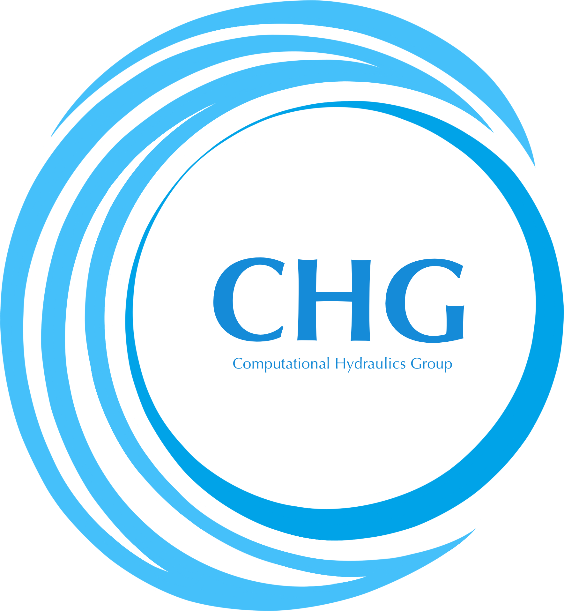{ .user-logo .logo-h84 }](http://chg.ices.utexas.edu/)
[{ .user-logo .logo-h56 }](https://www.utexas.edu/)  
Named after Butler, Estep and Tavener, **BET** is a Python package for data-consistent stochastic forward and inverse problems from the *Computational Hydraulics Group* at *The University of Texas at Austin*. Besides measure-based data-consistent stochastic inversion, it implements a broader range of data-consistent methods, with optional parallel features via mpi4py. Inside its sampling module, Latin hypercube samples of the input parameter space are generated by `lhs` from *PyDOE* using the center criterion.
> Source: <a href="https://github.com/UT-CHG/BET" style="color: #484848;">github.com/UT-CHG/BET</a>

 

[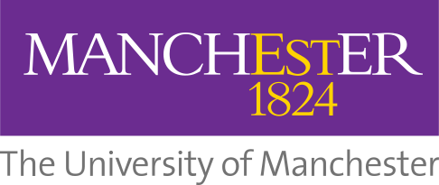{ .user-logo .logo-h56 }](https://www.manchester.ac.uk/)  
Statistical inference methods for biological data are the specialty of the *Manchester Bioinference Group* at *The University of Manchester*. Written with GPflow and TensorFlow Probability, the group's **GP_Transcription_Dynamics** code implements a Gaussian-process model of transcriptional regulation and reproduces the results of a study of mRNA decay dynamics in the Drosophila embryo, with gene filtering, parameter fitting and MCMC for uncertainty quantification.
> Source: <a href="https://github.com/ManchesterBioinference/GP_Transcription_Dynamics" style="color: #484848;">github.com/ManchesterBioinference/GP_Transcription_Dynamics</a>

 

[{ .user-logo .logo-h56 }](https://www.monash.edu/)  
Applied to tuberculosis, **AuTuMN** (the Australian Tuberculosis Modelling Network framework) is a set of Python models from the *Epidemiological Modelling Unit* at *Monash University* that modularises the development of dynamic disease-transmission models. Its legacy implementation, used until mid-2019, calls *PyDOE*'s `lhs` in the model runner to draw Latin hypercube samples of model parameters for uncertainty analysis. *PyDOE* is also used by the unit's COVID-19 school-closure and economic-impact models.
> Source: <a href="https://github.com/monash-emu/Legacy-AuTuMN" style="color: #484848;">github.com/monash-emu/Legacy-AuTuMN</a>

 

[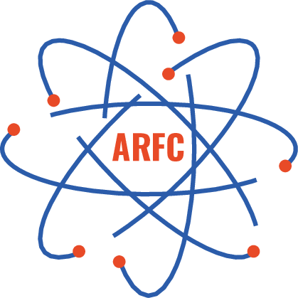{ .user-logo .logo-h84 }](https://arfc.github.io)
[{ .user-logo .logo-h63 }](https://www.wisc.edu/)  
**PRIDE** (**P**lan for **R**ap**I**d **DE**carbonization) gathers analysis tools, models and publications for planning rapid decarbonization from the *Advanced Reactors and Fuel Cycles* group in the *Department of Nuclear Engineering and Engineering Physics* at the *University of Wisconsin–Madison*. Its studies cover the hydrogen needed to make the MTD and UI vehicle fleets carbon-free and the optimal sizing of nuclear reactors under scenarios with cheaper reactors, more variable renewables, and hydrogen or thermal storage. Energy-system scenarios run in the **TEMOA** model, automated with Snakemake, while INL's **RAVEN** generates typical time histories.
> Source: <a href="https://github.com/arfc/pride" style="color: #484848;">github.com/arfc/pride</a>

 

[{ .user-logo .logo-h56 }](https://www.uu.nl/en)  
Multi-energy systems can be simulated and optimized with **AdOpT-NET0** (Advanced Optimization Tool for Networks and Energy), a Python package from the *Energy & Resources* group at *Utrecht University*. Conversion technologies and networks for any energy carrier are modeled, and both the design and the operation of the whole system are optimized. Pyomo builds the models, pvlib converts climate data into electricity output, tsam aggregates time series, and a companion visualization tool displays the results.
> Source: <a href="https://github.com/UU-ER/AdOpT-NET0" style="color: #484848;">github.com/UU-ER/AdOpT-NET0</a>

 

[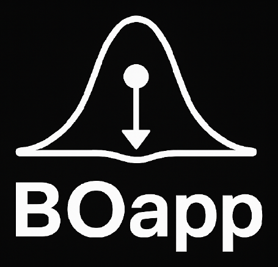{ .user-logo .logo-h77 }](https://github.com/BayesOptApp)
[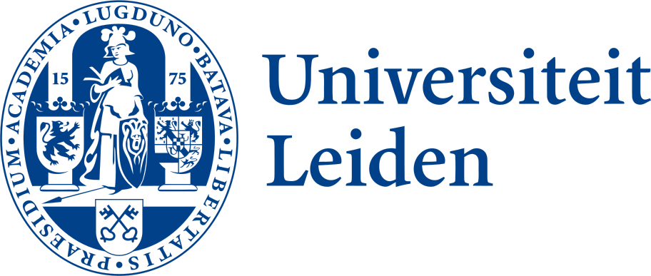{ .user-logo .logo-h70 }](https://www.universiteitleiden.nl/en)  
A study in *ACM Transactions on Evolutionary Learning and Optimization* (TELO) comparing high-dimensional Bayesian-optimization algorithms on the BBOB benchmark is backed by code that *Bayesian Optimization and Applications* maintains. Its modular framework makes vanilla Bayesian optimization (scikit-optimize), CMA-ES, random search, SAASBO, RDUCB, PCA-BO, KPCA-BO and TuRBO compatible with **IOHprofiler**, which logs their performance on the 24 BBOB functions of the COCO environment. Generated JSON files configure the experiments, and a single runner script launches them.
> Source: <a href="https://github.com/BayesOptApp/IOH-Profiler-HDBO-Comparison" style="color: #484848;">github.com/BayesOptApp/IOH-Profiler-HDBO-Comparison</a>

 

[{ .user-logo .logo-h84 }](http://silab.kaist.ac.kr/)
[{ .user-logo .logo-h49 }](https://www.kaist.ac.kr/en/)  
Improving the sample efficiency of deep reinforcement learning for combinatorial optimization is the point of Symmetric Replay Training, and the *Systems Intelligence Laboratory* at *KAIST* publishes the paper's code as **symmetric_replay**. The method is applied on top of existing DRL solvers (AM and POMO for the traveling salesman problem, Sym-NCO for vehicle routing, MatNet for the asymmetric TSP and REINVENT-SELFIES for molecular optimization) alongside the corresponding baselines.
> Source: <a href="https://github.com/kaist-silab/symmetric_replay" style="color: #484848;">github.com/kaist-silab/symmetric_replay</a>

 

[{ .user-logo .logo-h56 }](https://uni-tuebingen.de/en/)  
**HANNAH** (Hardware Accelerator and Neural network searcH), from the *Embedded Systems* group of the Department of Computer Science at the *University of Tübingen*, is a framework for hardware-aware neural architecture search. Poetry manages the project, which offers optional extras for vision models, ONNX-runtime and TensorFlow Lite backends, and DVC-based experiment management.
> Source: <a href="https://github.com/ekut-es/hannah" style="color: #484848;">github.com/ekut-es/hannah</a>

 

[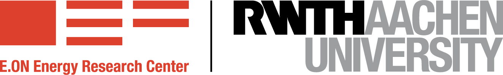{ .user-logo .logo-h42 }](https://www.ebc.eonerc.rwth-aachen.de/)
[{ .user-logo .logo-h49 }](https://www.rwth-aachen.de/)  
Of three projects from the *Institute for Energy Efficient Buildings and Indoor Climate* (*E.ON Energy Research Center*, *RWTH Aachen University*), two call *PyDOE*. **BESMod**, a Modelica library of modules for the domain-coupled simulation of building energy systems, won the best paper award at the American Modelica Conference 2022, and its bes-rules tooling calls `lhs` for the initial samples of a custom Bayesian-optimization loop for simulation-based optimization. Monte Carlo helpers in **pyCity_calc**, a pyCity add-on for energy-balance and economic calculations of city districts, perform Latin-hypercube sampling with `lhs` under the center, maximin and centermaximin criteria. The third, **pyCity_resilience**, is a pyCity add-on that identifies resilient energy-system configurations.

> Sources:  
<a href="https://github.com/RWTH-EBC/BESMod" style="color: #484848;">github.com/RWTH-EBC/BESMod</a>  
<a href="https://github.com/RWTH-EBC/pyCity_calc" style="color: #484848;">github.com/RWTH-EBC/pyCity_calc</a>  
<a href="https://github.com/RWTH-EBC/pyCity_resilience" style="color: #484848;">github.com/RWTH-EBC/pyCity_resilience</a>

 

[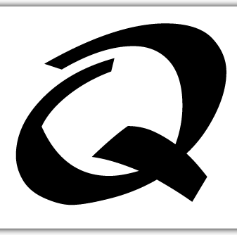{ .user-logo .logo-h84 }](https://github.com/QuLab-VU)
[{ .user-logo .logo-h49 }](https://www.vanderbilt.edu/)  
Drug synergy is quantified with **MuSyC**, a framework developed by *QuLab* at *Vanderbilt University*. MuSyC also has a web application, and the code for that application is kept in a separate repository, **musyc-web**.
> Source: <a href="https://github.com/QuLab-VU/musyc-web" style="color: #484848;">github.com/QuLab-VU/musyc-web</a>

 

[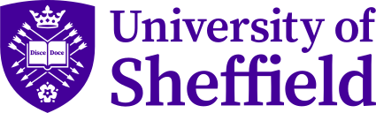{ .user-logo .logo-h56 }](https://www.sheffield.ac.uk/)  
The *University of Sheffield* machine learning group wrote **GPyOpt**, a library for Bayesian optimization with Gaussian processes built on GPy. Global optimization with a choice of acquisition functions, sequential or batch optimization of physical experiments, tuning the parameters of machine-learning algorithms and handling large data sets through sparse Gaussian-process models are all within its scope. The core team has since ended its maintenance. *PyDOE* is optional here: GPyOpt's Latin-hypercube experiment design calls `lhs` over the continuous variables, with the center criterion by default, to produce the initial points that seed the optimization loop.
> Source: <a href="https://github.com/SheffieldML/GPyOpt" style="color: #484848;">github.com/SheffieldML/GPyOpt</a>

 

[{ .user-logo .logo-h84 }](https://www.rc.virginia.edu/)
[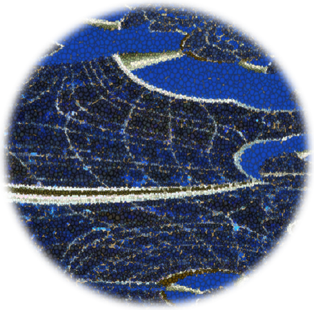{ .user-logo .logo-h77 }](http://uvahydroinformatics.org)
[{ .user-logo .logo-h56 }](https://www.virginia.edu/)  
Containers deployed on the high-performance computing cluster of the *University of Virginia* are built from **rivanna-docker**, the Docker and Apptainer recipes maintained by *Research Computing*, including a RHESSys container image. **pyRHESSys**, from the *Hydroinformatics Group*, is an object-oriented Python wrapper for the Regional Hydro-Ecologic Simulation System: it creates and manipulates model input, runs the model on local computers and on cyberinfrastructure such as CyberGIS-Jupyter for Water, visualizes outputs and exchanges test cases with HydroShare. Its README names automated model calibration and sensitivity analysis as future work.

> Sources:  
<a href="https://github.com/uvarc/rivanna-docker" style="color: #484848;">github.com/uvarc/rivanna-docker</a>  
<a href="https://github.com/uva-hydroinformatics/pyRHESSys" style="color: #484848;">github.com/uva-hydroinformatics/pyRHESSys</a>

 

[{ .user-logo .logo-h49 }](https://uwaterloo.ca/)  
Adaptive Gaussian-process model-predictive control is the subject of an ECC 2025 paper from the *CL2* lab at the *University of Waterloo*, whose code is published as **AdaptiveHGPMPC_ECC25**. Notebooks demonstrate the proposed adaptive likelihood-prior trade-off scheme on a toy example, show that it transfers to a closed-loop control task, and include an ablation of how adaptation speed affects control performance.
> Source: <a href="https://github.com/CL2-UWaterloo/AdaptiveHGPMPC_ECC25" style="color: #484848;">github.com/CL2-UWaterloo/AdaptiveHGPMPC_ECC25</a>

 

[{ .user-logo .logo-h63 }](https://photon.uni-muenster.de/)
[{ .user-logo .logo-h56 }](https://www.uni-muenster.de/)  
With **PHOTONAI**, a high-level Python API from the *Medical Machine Learning Lab* at the *University of Münster*, users design and optimize machine-learning pipelines. They select and combine pre-processing and learning algorithms from established toolboxes, arrange them in simple or parallel pipeline streams, and pick cross-validation schemes, performance metrics and hyperparameter-optimization strategies from pre-registered options, with room for custom components at every step. A PLOS ONE paper describes the framework. One of its hyperparameter-optimization backends is based on SMAC.
> Source: <a href="https://github.com/wwu-mmll/photonai" style="color: #484848;">github.com/wwu-mmll/photonai</a>

 

[{ .user-logo .logo-h84 }](https://www.context-lab.com/)
[{ .user-logo .logo-h35 }](https://home.dartmouth.edu/)  
In the hypercube notebook of the *Contextual Dynamics Laboratory*, *PyDOE*'s `ff2n` generates a two-level full factorial whose rows, rescaled from -1/+1 to the requested range, give the vertices of a hypercube in any number of dimensions. The lab, at *Dartmouth College*, publishes these Jupyter notebooks to accompany its paper on **HyperTools**, its Python toolbox for visualizing high-dimensional data. They are run against the released HyperTools package and tested with version 0.4.0.
> Source: <a href="https://github.com/ContextLab/hypertools-paper-notebooks" style="color: #484848;">github.com/ContextLab/hypertools-paper-notebooks</a>

 

[{ .user-logo .logo-h42 }](http://temoaproject.org)
[{ .user-logo .logo-h35 }](https://www.ncsu.edu/)  
*North Carolina State University* developed **Temoa** (**T**ools for **E**nergy **M**odel **O**ptimization and **A**nalysis), an open-source energy-system optimization framework used for long-term energy planning and analysis under uncertainty. Perfect-foresight and myopic planning, uncertainty analysis and the generation of alternative solutions are all supported. Temoa ships on PyPI with a command-line interface that builds and runs models from configuration files and SQLite databases.
> Source: <a href="https://github.com/TemoaProject/temoa" style="color: #484848;">github.com/TemoaProject/temoa</a>

 

[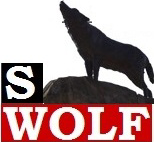{ .user-logo .logo-h84 }](https://swolfpy-project.github.io/)
[{ .user-logo .logo-h35 }](https://www.ncsu.edu/)  
Municipal solid-waste management gets a life-cycle assessment and optimization framework in **SwolfPy** (**S**olid **W**aste **O**ptimization **L**ife-cycle **F**ramework in **Py**thon), from *North Carolina State University*. Comparative LCA, contribution analysis and LCI reports are produced across process models such as landfill, parametric and Monte Carlo analyses examine sensitivity and uncertainty, and the optimizer minimizes environmental burdens or cost subject to technical and policy constraints. A multi-start optimization can begin from a Latin-hypercube design: choosing the LHS initial-guess option makes *PyDOE*'s `lhs` generate the starting points for the decision variables.
> Source: <a href="https://github.com/SwolfPy-Project/swolfpy" style="color: #484848;">github.com/SwolfPy-Project/swolfpy</a>

 

[{ .user-logo .logo-h49 }](https://www.sdu.dk/en)  
Parameter estimation in models compliant with the Functional Mock-up Interface (FMI), such as building and energy-system models, is handled by **modest-py** (ModestPy) from the *Center for Energy Informatics* at the *University of Southern Denmark*. Global and local search methods are combined (a genetic algorithm, pattern search, truncated Newton, L-BFGS-B and sequential least squares); the package works with non-continuous and non-differentiable models and scales to multiple cores. Within the genetic algorithm, sets of parameter values for the estimation are sampled by *PyDOE*'s `lhs` with the center criterion.
> Source: <a href="https://github.com/sdu-cfei/modest-py" style="color: #484848;">github.com/sdu-cfei/modest-py</a>

 

[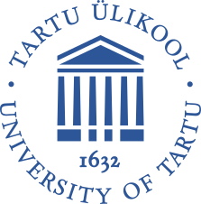{ .user-logo .logo-h84 }](https://bigdata.cs.ut.ee/)  
Non-technical users and domain experts are the audience of **iSmartML**, an interactive, user-guided framework from the *Data Systems Group* at the *University of Tartu* that improves the utility and usability of AutoML. It gives them a control panel for defining the search space, a meta-learning recommendation engine for search spaces, pre-processors and time budgets, a monitoring panel that alerts when a better pipeline is found, logging that avoids re-exploring configurations across runs, and an explanation module for diagnosing the returned models.
> Source: <a href="https://github.com/DataSystemsGroupUT/ismartml" style="color: #484848;">github.com/DataSystemsGroupUT/ismartml</a>

 

[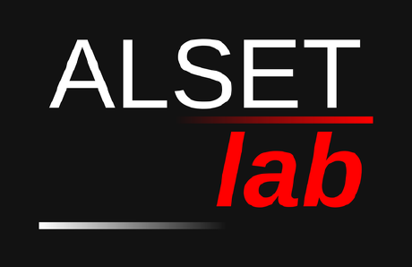{ .user-logo .logo-h63 }](http://alsetlab.com)
[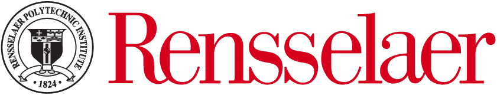{ .user-logo .logo-h49 }](https://www.rpi.edu/)  
Prof. Luigi Vanfretti's research team at *Rensselaer Polytechnic Institute*, *ALSETLab*, develops **ModelicaGridData**, a tool that generates power-grid dynamic-simulation data with Python and Modelica models for machine-learning applications. OpenIPSL phasor-domain simulation models are fed with power-flow solutions computed from real load-data patterns, such as data downloaded from NYISO, and the simulations run locally with Dymola or OpenModelica. Ready-made virtual machines are provided for testing.
> Source: <a href="https://github.com/ALSETLab/ModelicaGridData" style="color: #484848;">github.com/ALSETLab/ModelicaGridData</a>

 

[{ .user-logo .logo-h56 }](https://optgroup.it.jyu.fi/)
[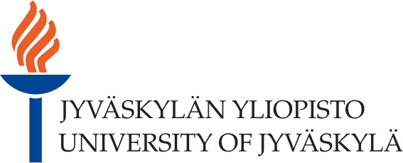{ .user-logo .logo-h70 }](https://www.jyu.fi/en)  
Two projects of *The Multiobjective Optimization Group* at the *University of Jyväskylä* use *PyDOE*: **pyRVEA** and **desdeo-emo**. pyRVEA implements the **R**eference **V**ector guided **E**volutionary **A**lgorithm in Python for multi-objective minimization, with visualization and interactive preferences given as reference points, and calls `lhs` both to create the initial population and to generate training data for its test problems. The evolutionary methods of the legacy **DESDEO** 1.0 interactive multiobjective optimization framework are provided by desdeo-emo, which relies on `lhs` for initial populations and reference vectors; its notebooks also sample training data with it for data-driven optimization with surrogate models such as BioGP and EvoNN.

> Sources:  
<a href="https://github.com/industrial-optimization-group/pyRVEA" style="color: #484848;">github.com/industrial-optimization-group/pyRVEA</a>  
<a href="https://github.com/industrial-optimization-group/desdeo-emo" style="color: #484848;">github.com/industrial-optimization-group/desdeo-emo</a>

 

[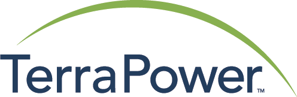{ .user-logo .logo-h63 }](https://www.terrapower.com/)  
*TerraPower*'s open-source Python framework for nuclear-reactor design and analysis is **ARMI** (**A**dvanced **R**eactor **M**odeling **I**nterface). It provides a flexible reactor data model, standardized communication between physics kernels through ARMI plugins, dependable input and output formats, and an ecosystem for multi-disciplinary simulation of core physics such as fuel performance and neutronics. Teams use it on large compute clusters to run thousands of perturbed cases in parallel for design decisions and sensitivity analyses. *PyDOE* has been used in its case-suite tooling through a `LatinHyperCubeSuiteBuilder`, which builds suites of perturbed cases from a Latin-hypercube design.
> Source: <a href="https://github.com/terrapower/armi" style="color: #484848;">github.com/terrapower/armi</a>

 

[{ .user-logo .logo-h63 }](https://erigrid2.eu/)  
Within *ERIGrid 2.0*, the European Horizon 2020 research infrastructure for smart grid and smart energy systems, a toolbox of design-of-experiments and sensitivity-analysis methods called **toolbox_doe_sa** was developed. It reads simulation parameters from a JSON configuration, generates parameter variations, runs simulation or laboratory experiments and analyzes the results, pairing sampling schemes (Sobol' sequences, extreme points, LHS, Sobol' indices, eFAST) with analyses such as meta models, ANOVA and Sobol' indices. Its example scenario is a multi-energy networks benchmark model. Latin hypercube samples over the varied factors come from *PyDOE*'s `lhs` and become the parameter sets of the individual simulation runs.
> Source: <a href="https://github.com/ERIGrid2/toolbox_doe_sa" style="color: #484848;">github.com/ERIGrid2/toolbox_doe_sa</a>

 

[{ .user-logo .logo-h42 }](https://iosea-project.eu/)  
Choosing the storage tier for each I/O phase so as to reduce total workflow duration and Burst Buffer usage is the goal of the **recommendation-system** built in the European *IO-SEA* project, which optimizes data placement for High-Performance Computing workflows. An application decomposer analyzes each job's I/O behavior, a performance model predicts I/O latency on each storage tier and an execution simulator virtually replays the workflow, while optimization heuristics driven by a black-box optimization engine explore the parameter space.
> Source: <a href="https://github.com/io-sea/recommendation-system" style="color: #484848;">github.com/io-sea/recommendation-system</a>

 

[{ .user-logo .logo-h49 }](https://gemseo.org)  
*IRT Saint Exupéry* develops **GEMSEO** (**G**eneric **E**ngine for **M**ultidisciplinary **S**cenarios, **E**xploration and **O**ptimization), an open-source library that automates multidisciplinary processes, starting with multidisciplinary design optimization (MDO). Disciplines wrapping Python, Matlab, Scilab, Excel or executables are assembled into MDO formulations, and the library provides coupling, optimization, design of experiments, surrogate models, machine learning and uncertainty quantification. Through its PyDOE algorithms library, *PyDOE* is exposed as DOE algorithms such as `PYDOE_LHS` and `PYDOE_FULLFACT` for scenario sampling and for training and calibrating surrogate models. Examples and tests of the **gemseo-umdo** plugin (MDO under uncertainty) run `PYDOE_FULLFACT` designs, and the wider ecosystem includes the **gemseo-petsc** (PETSc linear and ODE solvers), **gemseo-mma** (Method of Moving Asymptotes) and **gemseo-benchmark** (benchmarking of optimization algorithms) plugins.

> Sources:  
<a href="https://github.com/gemseo/gemseo" style="color: #484848;">github.com/gemseo/gemseo</a>  
<a href="https://github.com/gemseo/gemseo-umdo" style="color: #484848;">github.com/gemseo/gemseo-umdo</a>  
<a href="https://github.com/gemseo/gemseo-petsc" style="color: #484848;">github.com/gemseo/gemseo-petsc</a>  
<a href="https://github.com/gemseo/gemseo-mma" style="color: #484848;">github.com/gemseo/gemseo-mma</a>  
<a href="https://github.com/gemseo/gemseo-benchmark" style="color: #484848;">github.com/gemseo/gemseo-benchmark</a>

 

[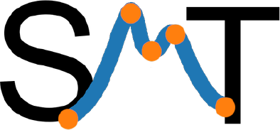{ .user-logo .logo-h63 }](https://smt.readthedocs.io/)  
Developed jointly by *ONERA* (the French Aerospace Lab), *NASA Glenn Research Center*, *ISAE-SUPAERO/ICA* and the *University of Michigan* MDO Lab, **SMT** (**S**urrogate **M**odeling **T**oolbox) is a Python library of surrogate modeling methods, sampling techniques and benchmarking functions. It emphasizes derivatives (gradient-enhanced training, prediction derivatives and derivatives with respect to training data) and Kriging with mixed and hierarchical variables, including partial-least-squares Kriging. *PyDOE* is a core dependency. SMT's `LHS` sampling method is built on *PyDOE*'s `lhs`, while `BoxBehnken`, `Factorial`, `Gsd` and `PlackettBurman` adapt `bbdesign`, `fullfact`, `gsd` and `pbdesign` to SMT's sampling interface to generate surrogate training points.
> Source: <a href="https://github.com/SMTorg/smt" style="color: #484848;">github.com/SMTorg/smt</a>

 

[{ .user-logo .logo-h84 }](https://www.deltares.nl/en/)
[{ .user-logo .logo-h42 }](https://www.deltares.nl/en/)  
NVIDIA PhysicsNeMo is the basis of **PhysicsNeMo-projects**, a collection of runnable deep-learning projects and examples maintained by *Deltares*, the Dutch independent institute for applied research on water and subsurface. Archived and migrated Sym-based examples, such as wave-equation and 2D/3D reservoir-simulation workflows, sit alongside guidance for installing PhysicsNeMo on GPU workstations. The reservoir-simulation examples import `lhs` from *PyDOE* and expose it as a sampling option that scales Latin hypercube samples to a given parameter interval.
> Source: <a href="https://github.com/Deltares-research/PhysicsNeMo-projects" style="color: #484848;">github.com/Deltares-research/PhysicsNeMo-projects</a>

 

[{ .user-logo .logo-h84 }](https://github.com/helix-agh)
[{ .user-logo .logo-h84 }](https://www.agh.edu.pl/en)  
Automatic design of optimization test problems with large language models is the topic of the paper accompanied by **ela-guided-llm-bench**, from *HELIX* (**H**euristics, **E**volution and **L**earning for **I**ntelligent e**X**ploration) at *AGH University of Kraków*. Its methods take target exploratory landscape analysis (ELA) feature values extracted from BBOB or MA-BBOB problems and evolve Python functions whose landscape characteristics match those targets. The comparison covers the ELA-guided EoTF algorithm, LLaMEA, a zero-shot baseline and a genetic-programming baseline.
> Source: <a href="https://github.com/helix-agh/ela-guided-llm-bench" style="color: #484848;">github.com/helix-agh/ela-guided-llm-bench</a>

 

[{ .user-logo .logo-h84 }](https://www.swiftsim.com)  
Instead of running every cosmological simulation, **SWIFT-Emulator** from the *SWIFT* astrophysics simulation collaboration predicts their outputs, using Gaussian process regression with george and sensitivity analysis with SALib. A single consistent API covers building a model design, reading SWIFT data, training an emulator on a few base simulations, validating it, comparing it against observations across parameter space and visualizing the results. The base simulations are run at a Latin hypercube design of model parameters, which *PyDOE*'s `lhs` generates with the `maximin` criterion.
> Source: <a href="https://github.com/SWIFTSIM/emulator" style="color: #484848;">github.com/SWIFTSIM/emulator</a>

 

[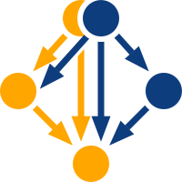{ .user-logo .logo-h84 }](https://spack.io)  
Multiple versions, configurations, platforms and compilers are supported by *Spack*, the flexible package manager for HPC systems. Its **pypi-to-spack-package** tool imports the latest PyPI metadata from the public BigQuery dataset into a local SQLite database, performs trivial version bumps of existing Python `package.py` recipes and can generate a full Spack repository from a list of requirements.
> Source: <a href="https://github.com/spack/pypi-to-spack-package" style="color: #484848;">github.com/spack/pypi-to-spack-package</a>

 

[{ .user-logo .logo-h84 }](https://symbench.github.io/Anvil)  
In **Anvil**, an open-source scientific-machine-learning tool from *Symbench* for CFD-based design evaluation, FreeCAD generates shapes from a parametric CAD seed design and OpenFOAM analyzes them. Three modes are available: CFD analysis of a single STL file, automatic data generation over a design space for a given evaluation budget, and Bayesian optimization with a user-defined acquisition function. The generated data can also train low-fidelity surrogate models of the CFD process. To select the designs to evaluate, the samplers call *PyDOE*'s `lhs` with the `maximin` and `corr` criteria and scale the result to the design-parameter ranges.
> Source: <a href="https://github.com/symbench/Anvil" style="color: #484848;">github.com/symbench/Anvil</a>

 

[{ .user-logo .logo-h84 }](https://flowcean.me)  
Models of cyber-physical systems can be defined, simulated, identified, evaluated and reproduced with **flowcean**, a research-oriented Python toolkit that builds on research into automatic model generation. Hybrid systems with continuous dynamics, events, transitions and resets are supported, hybrid dynamics and mode selectors are identified with HyDRA, and models can be learned from offline datasets, incremental streams and active environments. Environments, transforms, learners, metrics and evaluation strategies are reusable components, with adapters for established Python ML libraries.
> Source: <a href="https://github.com/flowcean/flowcean" style="color: #484848;">github.com/flowcean/flowcean</a>

 

[{ .user-logo .logo-h56 }](https://systemsengineering.design/)  
The margin value method of Brahma and Wynn for design-space exploration is implemented in **mvmlib** by the *Systems Engineering Design Group* (Gothenburg, Sweden). According to its documentation, matplotlib serves visualization, scikit-fuzzy serves fuzzy-logic modeling and *PyDOE* serves design-space exploration. Inside the DOE module, `lhs` from *PyDOE* builds Latin hypercube designs between the lower and upper bounds of the design variables, and full-factorial designs are offered alongside.
> Source: <a href="https://github.com/sed-group/mvmlib" style="color: #484848;">github.com/sed-group/mvmlib</a>

 

[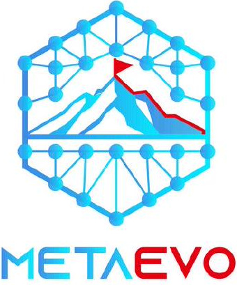{ .user-logo .logo-h84 }](https://github.com/MetaEvo)  
Next-generation evolutionary computation and meta-black-box optimization are the research topics of the *MetaEvolution Lab*. Accepted at GECCO 2025, its **APDMMO** performs accurate peak detection in multimodal optimization via approximated landscape learning, in three stages: global landscape fitting trains a landscape learner for a problem, free-of-trial peak detection locates potential peak areas, and parallel local search refines the solutions. Evaluation uses peak ratio and success rate on the CEC2013 multimodal optimization benchmark.
> Source: <a href="https://github.com/MetaEvo/APDMMO" style="color: #484848;">github.com/MetaEvo/APDMMO</a>

 

[{ .user-logo .logo-h84 }](https://github.com/stk-kriging)  
Bayesian sequential design of computer experiments for quantile set inversion is the topic of an article whose data and scripts, **qsi-paper-experiments**, were published by the team behind *STK*, a small toolbox for Kriging (*Université Paris-Saclay*, *CNRS*, *CentraleSupélec* and *EDF R&D*). Most experiments use Matlab with STK and the contrib-qsi repository, and a demonstration shows the QSI-SUR strategy choosing points from a random initial design. Python is needed only to reproduce the results of the ECL algorithm of Cole et al. (2023), used for comparison.
> Source: <a href="https://github.com/stk-kriging/qsi-paper-experiments" style="color: #484848;">github.com/stk-kriging/qsi-paper-experiments</a>

 

[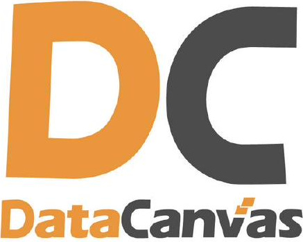{ .user-logo .logo-h77 }](https://www.datacanvas.com/)  
Tabular data is the target of **DeepTables**, *DataCanvas*'s deep-learning toolkit with automated architecture and hyperparameter search. It aims to learn feature interactions efficiently in neural networks, bringing models from CTR prediction research (such as DeepFM, Wide&Deep, DCN and PNN) to general tabular data in an end-to-end toolkit. Non-experts should find it easy to use, it is meant to perform well out of the box, and it is designed to be easily extended.
> Source: <a href="https://github.com/DataCanvasIO/DeepTables" style="color: #484848;">github.com/DataCanvasIO/DeepTables</a>

 

[{ .user-logo .logo-h56 }](https://www.qubole.com)  
Apache Spark application configurations are auto-tuned with machine learning and mathematical models by **uchit**, which *Qubole*, a cloud big-data platform for analysts and data engineers, built and which was presented at Spark+AI Summit Europe 2019. An ML model is trained on the configurations and run times of previous runs; candidate configurations are then sampled, non-optimal ones are pruned with domain-specific models, and the best-performing configuration is predicted. To pick representative configurations covering the whole combined configuration space, the discrete sampler runs *PyDOE*'s `lhs` with the `center` criterion.
> Source: <a href="https://github.com/qubole/uchit" style="color: #484848;">github.com/qubole/uchit</a>

 

[{ .user-logo .logo-h49 }](https://dessia.io)  
Python apps that can be uploaded to and interpreted by Dessia platform instances are built with an SDK whose common part, **dessia_common**, comes from *DessIA Technologies*, a Paris-based engineering-software company. Objects that inherit from its `DessiaObject` base class gain the abilities needed to be handled by the platform, and its datatools include sampling utilities for design studies. The sampling module generates designs of experiments over the sampled attributes of engineering objects with *PyDOE*'s `fullfact` and `lhs` (with a selectable criterion), next to Monte Carlo sampling.
> Source: <a href="https://github.com/Dessia-tech/dessia_common" style="color: #484848;">github.com/Dessia-tech/dessia_common</a>

 

[{ .user-logo .logo-h84 }](https://www.djura.it/)  
OpenSeesPy structural models are built and run with **opensees-modeller**, a set of scripts maintained by *Djura*, a risk-data engineering company. To simulate correlated demand parameters, its demand module draws Latin hypercube realizations with *PyDOE*'s `lhs` and maps them to standard-normal variates through the normal inverse CDF.
> Source: <a href="https://github.com/djura-risk-data-engineering/opensees-modeller" style="color: #484848;">github.com/djura-risk-data-engineering/opensees-modeller</a>

 

[{ .user-logo .logo-h56 }](https://fijishi.com/fijishi-sdgs/)  
GridCal, a pure-Python platform for power systems research and simulation, is the base of **RS-Cross-Power-System**, one of the open-source sustainable-development projects maintained by *Fijishi*, a UK company. Its features include AC/DC power flow with several Newton-Raphson and approximate methods, optimal power flow and generation dispatch, time series with profiles, PTDF-based flow estimation, Monte Carlo and Latin hypercube stochastic power flow, blackout cascading, short-circuit analysis, and import and export of formats such as CIM, PSS/e and Matpower.
> Source: <a href="https://github.com/Fijishi-Enterprises/RS-Cross-Power-System" style="color: #484848;">github.com/Fijishi-Enterprises/RS-Cross-Power-System</a>
